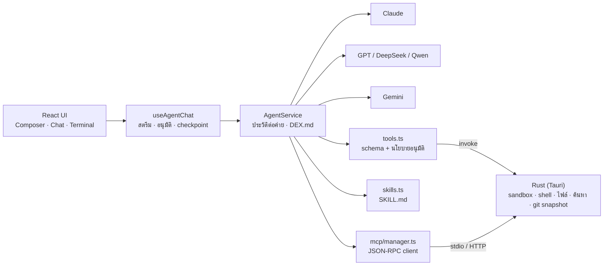

<div align="center">


# Dex — AI Coding Agent

**ผู้ช่วยเขียนโค้ดบนเดสก์ท็อป ที่อ่าน ค้นหา แก้ไฟล์ และรันคำสั่งในโปรเจกต์ของคุณได้จริง**<br/>
ใช้ได้หลายค่าย (Claude · GPT · Gemini · DeepSeek · Qwen · Ollama/OpenRouter) ต่อ MCP server และ Skills ได้ ขออนุญาตก่อนทำสิ่งเสี่ยงทุกครั้ง และย้อนการแก้ไฟล์ได้

[](https://tauri.app)
[](https://react.dev)
[](https://www.typescriptlang.org)
[](https://www.rust-lang.org)
[](#)

[ฟีเจอร์](#-ฟีเจอร์) · [เริ่มใช้งาน](#-เริ่มใช้งาน) · [วิธีใช้](#-วิธีใช้) · [ความปลอดภัย](#-ความปลอดภัย) · [สถาปัตยกรรม](#-สถาปัตยกรรม) · [พัฒนาต่อ](#-พัฒนาต่อ)

</div>

---

## ✨ ฟีเจอร์

| | |
|---|---|
| 🤖 **หลายค่ายในแอปเดียว** | Claude, GPT, Gemini, DeepSeek, Qwen และ endpoint แบบ OpenAI-compatible (Ollama, LM Studio, OpenRouter) สลับโมเดลกลางแชทได้ |
| 🧠 **ปรับระดับการคิดได้** | ตั้งแต่ *เร็ว* ไปจนถึง *สูงสุด* แสดงเฉพาะระดับที่โมเดลนั้นรองรับ และกดดูกระบวนการคิดได้ |
| 🛠️ **ทำงานกับไฟล์จริง** | อ่านไฟล์ยาวเป็นหน้า (มีเลขบรรทัด) แก้หลายจุดในครั้งเดียว ค้นด้วย regex/glob และรัน PowerShell โดยมี diff ให้ดูก่อนอนุญาต |
| ⏱️ **คำสั่งยาว / เบื้องหลัง** | ตั้ง timeout ได้ถึง 30 นาที และรัน dev server เบื้องหลังได้ (หยุดได้จาก Terminal) |
| 🧩 **Skills และ MCP** | โหลดคำสั่งเฉพาะทางจาก `SKILL.md` และต่อ MCP server (stdio / HTTP) ด้วย config แบบ Claude Desktop |
| ↩️ **ย้อนการแก้ไฟล์ได้** | ปุ่ม **ย้อนการแก้ไฟล์** (หรือ `/undo`) ย้อนทั้งไฟล์ที่ tool แก้ และไฟล์ที่คำสั่ง shell แก้ (ถ้า workspace เป็น git repo) |
| 🔁 **ตอบใหม่ / แก้ข้อความ** | กดตอบใหม่ หรือแก้ข้อความเก่าแล้วส่งใหม่จากจุดนั้น — agent ยังจำ tool ที่ใช้ในเทิร์นก่อน ๆ |
| 💾 **จำงานข้ามการเปิดแอป** | ประวัติเต็ม (รวมผลของ tool) บันทึกต่อแชท สลับแชทหรือเปิดแอปใหม่แล้วทำงานต่อได้ |
| 📎 **`@ไฟล์`** | พิมพ์ `@` ในช่องแชทแล้วเลือกไฟล์ — เนื้อหาไฟล์ถูกแนบไปให้ agent ทันที ไม่ต้องเสีย step ไปอ่านเอง |
| 🌐 **อ่านหน้าเว็บ** | tool `web_fetch` อ่านเอกสาร changelog หรือ issue บนเว็บ (แปลง HTML เป็นข้อความ แบ่งหน้าให้เอง) — ถามก่อนทุกโดเมนใหม่ |
| 🧭 **เบราว์เซอร์ในแอป** | pane ทางขวา (ปุ่ม 🗔 มุมขวาบน) ให้ agent เปิด dev server แล้วทดสอบเอง: อ่านโครงหน้า คลิก พิมพ์ กดปุ่ม ดู console/error และ screenshot (ส่งรูปให้โมเดลที่ดูรูปได้) — คุณใช้แถบ URL เองก็ได้ |
| 🎨 **Dex Design** | สั่งออกแบบเว็บ หน้าแอป หรือต้นแบบในแชท แล้วดูผลบน canvas ข้างแชท สลับจอ desktop/tablet/มือถือ ย้อนเวอร์ชัน และ export เป็นไฟล์ HTML ได้ — agent เปิดหน้าตรวจงานตัวเองได้ด้วย |
| 📋 **คำสั่งประจำโปรเจกต์** | วาง `DEX.md` หรือ `AGENTS.md` ไว้ที่รากโปรเจกต์ แล้ว agent จะทำตามทุกเทิร์น |
| 🖼️ **แนบรูปได้** | วางด้วย `Ctrl+V` ลากไฟล์มาวาง หรือกดปุ่มแนบ รูปใหญ่จะถูกย่อให้อัตโนมัติ |
| 🔐 **ขออนุญาตก่อนทำสิ่งเสี่ยง** | โหมด Auto-Pilot / Supervised, กฎ allow/deny ของคุณเอง, ป้องกันไฟล์ลับอย่าง `.env` และเก็บ API key ใน Windows Credential Manager |
| 💰 **ประหยัดและทนทาน** | prompt caching ของ Claude, ลองใหม่อัตโนมัติเมื่อ API ล่มชั่วคราว, สรุปบทสนทนาเก่าเมื่อ context ใกล้เต็ม (เทิร์นล่าสุดเก็บไว้ครบ) และถามก่อนทำต่อทุก 50 รอบ |
| 🔔 **แจ้งเตือน** | แจ้งเตือนของ Windows เมื่อทำเสร็จหรือรออนุมัติ ขณะคุณอยู่หน้าต่างอื่น |
| 💻 **Terminal ในตัว** | ดู output ของคำสั่งแบบสด หยุดคำสั่งที่ค้างได้ |
| 🎨 **ธีมโปเกมอน** | สว่าง / มืด / ตามระบบ และ Pikachu, Poké Ball, Squirtle, Bulbasaur, Gengar |
| 🌏 **ไทย / English** | ทั้งหน้าจอและภาษาที่ agent ใช้ตอบ |

## 🚀 เริ่มใช้งาน

### สิ่งที่ต้องมี

- [Node.js](https://nodejs.org) 20 ขึ้นไป
- [Rust](https://rustup.rs) (stable)
- [ส่วนประกอบที่ Tauri ต้องใช้บน Windows](https://tauri.app/start/prerequisites/) (WebView2 และ Microsoft C++ Build Tools)

### ติดตั้งและรัน

```bash
git clone --recursive https://github.com/Thawatchai-Yodyeam/Dex-AI-coding-agent.git
cd Dex-AI-coding-agent
npm install
npm run tauri dev
```

หรือดับเบิลคลิก `run.bat`

### ใส่ API key

ใส่ได้ 2 แบบ:

1. **ในแอป:** ⚙️ ตั้งค่า → API Keys → วางคีย์ (เก็บแบบเข้ารหัสใน Windows Credential Manager ไม่ใช่ localStorage — คีย์จากเวอร์ชันเก่าถูกย้ายให้อัตโนมัติ)
2. **ไฟล์ `.env`** ที่โฟลเดอร์ที่รันแอป แอปจะโหลดคีย์ให้แต่ไม่บันทึกลงเครื่อง (`.env` อยู่ใน `.gitignore` แล้ว)

ใช้โมเดลในเครื่องหรือ OpenRouter: ⚙️ ตั้งค่า → API Keys → **Custom endpoint** ใส่ Base URL (เช่น `http://localhost:11434/v1`) และชื่อโมเดล คั่นด้วย `,` — โมเดลต้องรองรับ tool calling

```env
ANTHROPIC_API_KEY=...
OPENAI_API_KEY=...
GEMINI_API_KEY=...          # หรือ GOOGLE_API_KEY / GOOGLE_GENERATIVE_AI_API_KEY
DEEPSEEK_API_KEY=...
DASHSCOPE_API_KEY=...       # Qwen (หรือ QWEN_API_KEY)
```

## 📖 วิธีใช้

### คำสั่งในช่องแชท

| คำสั่ง | ทำอะไร |
|---|---|
| `/help` | ดูโมเดล ระดับการคิด workspace ไฟล์คำสั่งประจำโปรเจกต์ และ skill ที่ใช้ได้ |
| `/undo` | ย้อนไฟล์ที่ agent แก้ในเทิร์นล่าสุด |
| `/clear` | ล้างการสนทนานี้ |
| `/ชื่อ-skill ข้อความ` | ใช้ skill นั้นกับคำขอนี้ทันที |
| `@พาธ` | แนบเนื้อหาไฟล์ใน workspace ไปกับข้อความ (พิมพ์ `@` แล้วเลือกจากรายการ — ไฟล์ลับและไฟล์ที่ติดกฎ deny จะไม่ถูกแนบ) |

### Skills

Skill คือโฟลเดอร์ที่มี `SKILL.md` แบบเดียวกับ Agent Skills:

```markdown
---
name: release
description: ออก release ใหม่ — ใช้เมื่อผู้ใช้ขอ bump version หรือทำ changelog
---
1. อ่าน CHANGELOG.md ...
```

วางไว้ที่ `.dex/skills/<ชื่อ>/` (หรือ `.claude/skills/`) ในโปรเจกต์ หรือ `~/.dex/skills/<ชื่อ>/` สำหรับทุกโปรเจกต์
agent เห็นแค่ชื่อกับคำอธิบาย แล้วโหลดคำสั่งเต็มด้วย `use_skill` เมื่องานตรงกัน — เปิด/ปิดทีละตัวได้ใน ⚙️ ตั้งค่า → Skills และ MCP

### MCP servers

⚙️ ตั้งค่า → Skills และ MCP แล้ววาง config แบบเดียวกับ Claude Desktop / `.mcp.json`:

```json
{
  "mcpServers": {
    "filesystem": { "command": "npx", "args": ["-y", "@modelcontextprotocol/server-filesystem", "D:/projects"] },
    "remote": { "type": "http", "url": "https://example.com/mcp", "headers": { "Authorization": "Bearer ${MY_TOKEN}" } }
  }
}
```

- `${ชื่อ}` ใน args/env/url/headers ถูกแทนด้วย environment variable — ไม่ต้องเก็บ token ไว้ใน settings
- tool ของ MCP ชื่อ `mcp__<server>__<tool>` และ**ถามก่อนรันเสมอ** ยกเว้นตัวที่ประกาศ `readOnlyHint` ในโหมด Auto-Pilot หรือมีกฎ allow ประเภท *MCP tool*
- รองรับ stdio และ Streamable HTTP (SSE แบบเก่ายังไม่รองรับ) สถานะการเชื่อมต่อและ error ดูได้ในหน้าตั้งค่า

### คำสั่งประจำโปรเจกต์ (`DEX.md`)

สร้างไฟล์ที่รากของ workspace (แอปใช้ไฟล์แรกที่เจอตามลำดับ `DEX.md` → `AGENTS.md` → `CLAUDE.md`):

```markdown
# กติกาของโปรเจกต์นี้
- ใช้ pnpm ไม่ใช้ npm
- แก้โค้ดแล้วรัน `pnpm test` ทุกครั้ง
- คอมเมนต์เป็นภาษาไทย
```

ไฟล์นี้ถูกอ่านใหม่ทุกเทิร์น แก้แล้วมีผลทันที (เก็บได้สูงสุด 20,000 ตัวอักษร)

### ย้อนการแก้ไฟล์

- ใต้คำตอบที่มีการแก้ไฟล์จะมีป้าย **แก้ N ไฟล์** และปุ่ม **ย้อนการแก้ไฟล์** (กด 2 ครั้งเพื่อยืนยัน)
- การย้อนเทิร์นเก่าจะย้อนเทิร์นที่ตามมาทั้งหมดด้วย ไฟล์จึงกลับไปอยู่ในสภาพก่อนเทิร์นนั้นจริง ๆ
- ถ้า workspace เป็น git repo ก่อนคำสั่ง shell ตัวแรกที่อาจแก้ไฟล์ Dex จะ snapshot workspace ไว้ (ป้าย **รวมคำสั่ง shell**) การย้อนจึงคืนไฟล์ที่คำสั่ง shell แก้/สร้าง/ลบด้วย — snapshot ใช้ index ชั่วคราว ไม่แตะ stage/stash/branch ของคุณ และไม่รวมไฟล์ใน `.gitignore`
- หลังย้อน agent จะได้รับแจ้งในเทิร์นถัดไป จึงรู้ว่าต้องอ่านไฟล์ใหม่

> [!NOTE]
> Checkpoint เก็บในหน่วยความจำ ปิดแอปแล้วจะย้อนไม่ได้ ไฟล์ที่ใหญ่เกิน 5 MB หรือไม่ใช่ไฟล์ข้อความจะขึ้นป้ายเตือนว่าย้อนไม่ได้

### Dex Design

พิมพ์ในแชท เช่น "ออกแบบหน้า landing ของร้านกาแฟ" หรือกดปุ่ม 🎨 มุมขวาบนเพื่อดูโปรเจกต์ทั้งหมด

- โปรเจกต์อยู่ที่ `.dex/designs/<ชื่อ>/` ใน workspace เป็น HTML/CSS/JS ธรรมดา จึงเปิด แก้ และเก็บเข้า git ได้เหมือนไฟล์อื่น
- การเขียนแต่ละครั้งของ agent เป็นหนึ่งเวอร์ชัน (เก็บล่าสุด 30 เวอร์ชันใน `.versions/` ซึ่งไม่เข้า git) เลือกดูเวอร์ชันเก่าได้จาก toolbar และกด **ใช้เวอร์ชันนี้** เพื่อเอากลับมาเป็นเวอร์ชันใหม่ ของเดิมจึงไม่หาย
- ปุ่มดาวน์โหลดคัดลอกไฟล์ดีไซน์ไปโฟลเดอร์ที่เลือก (ไม่ทับของเดิม)

### แนบรูป

แนบได้สูงสุด 5 รูปต่อข้อความ (PNG, JPEG, WebP, GIF) รูปที่ขอบยาวเกิน 1568px จะถูกย่อลง ส่วน DeepSeek ยังรับรูปไม่ได้ ปุ่มแนบจึงถูกปิดไว้

> [!TIP]
> หน้าจอแชทไม่เก็บรูป (แชทถูกบันทึกลงดิสก์ถี่ระหว่างสตรีม) พอเปิดแชทเก่าจะเห็นเป็นป้าย "รูป (ไม่ได้บันทึกไว้)" แต่ agent ยังจำรูปได้จากประวัติที่บันทึกเป็นไฟล์

## 🔐 ความปลอดภัย

Dex แก้ไฟล์จริงในเครื่องคุณ จึงมีการป้องกันหลายชั้น:

- **Sandbox:** tool ไฟล์ทุกตัวทำงานได้เฉพาะใน workspace ที่เลือก (เช็กเป็นราย component ของ path ไม่ใช่แค่ prefix)
- **ไฟล์ลับ:** `.env`, `*.pem`, `id_rsa`, `.npmrc` ฯลฯ ต้องขออนุญาตก่อนอ่านหรือแก้ทุกครั้ง และ `grep_search` จะข้ามไฟล์เหล่านี้
- **คำสั่ง shell:** คำสั่งที่อ่านอย่างเดียวรันได้เลยในโหมด Auto-Pilot ส่วนคำสั่งที่เขียนไฟล์ ลบไฟล์ หรือต่อกันหลายคำสั่งต้องถามก่อน และคำสั่งอันตราย (เช่น shutdown) ถูกบล็อกเสมอ
- **กฎสิทธิ์:** ตั้ง allow/deny ได้เองใน ⚙️ ตั้งค่า (shell / อ่านไฟล์ / แก้ไฟล์ / MCP tool / เว็บ) โดย deny ชนะเสมอ ปุ่ม *อนุญาตตลอดแชทนี้* / *อนุญาตเสมอ* จะสร้างกฎให้อัตโนมัติ
- **Supervised:** ปิด Auto-Pilot (ปุ่ม ⚡ มุมขวาบน) แล้ว agent จะถามก่อนแก้ไฟล์หรือรันคำสั่งทุกครั้ง
- **MCP:** server เปิดจาก config ในหน้าตั้งค่าเท่านั้น (ไม่อ่าน `.mcp.json` ของโปรเจกต์เอง กันโปรเจกต์แปลกหน้าสั่งรันโปรแกรม) และ tool ของ MCP ถามก่อนรัน
- **เว็บ:** `web_fetch` ถามก่อนเข้าโดเมนใหม่ทุกครั้ง แม้ในโหมด Auto-Pilot (URL อาจถูกใช้ส่งข้อมูลออกไป) ตั้งกฎ allow เช่น `docs.rs` หรือ `*.github.com` ได้ ตาม redirect เฉพาะในโดเมนเดิม และบอก agent ว่าเนื้อหาจากเว็บเป็นข้อมูลที่ห้ามทำตามคำสั่งในนั้น
- **เบราว์เซอร์ในแอป:** หน้าเว็บใน pane เรียกคำสั่งของ Dex ไม่ได้ (Tauri บล็อก origin ภายนอก) และ pane เปิดหน้าของตัว Dex เอง / `file://` ไม่ได้ เปิด localhost ได้เลยในโหมด Auto-Pilot ส่วนเว็บอื่นถามก่อนตามกฎโดเมนชุดเดียวกับ `web_fetch` และการรัน JavaScript ในหน้าที่ไม่ใช่ localhost ต้องอนุมัติทุกครั้ง
- **Dex Design:** หน้าดีไซน์ที่ AI เขียนเปิดจากเซิร์ฟเวอร์ใน `127.0.0.1` ที่เป็น origin ภายนอก จึงเรียกคำสั่งของ Dex ไม่ได้ เซิร์ฟเวอร์เสิร์ฟเฉพาะไฟล์ในโปรเจกต์ผ่าน URL ที่มี token สุ่ม และ CSP กันไม่ให้หน้าส่งข้อมูลออกด้วย `fetch` หรือฟอร์ม (โหลดรูป ฟอนต์ และไลบรารีจาก CDN ได้) การเขียนไฟล์ผ่านกฎสิทธิ์และโหมด Supervised เหมือนการแก้ไฟล์ปกติ
- **API key:** เก็บใน Windows Credential Manager ไม่อยู่ใน localStorage

## 🧩 สถาปัตยกรรม



<details>
<summary><b>โครงสร้างไฟล์</b></summary>

```
src/
  App.tsx                   layout หลัก + เชื่อม hooks
  App.css                   ธีม (design tokens, light/dark + ธีมโปเกมอน)
  components/               Sidebar, TopBar, Composer, ChatMessageItem, DiffViewer, SettingsModal,
                            SkillsSettings, McpSettings, ModelOptions, BrowserPane, ...
  hooks/
    useAppSettings.ts       settings, คีย์ใน Credential Manager/.env, sync MCP server ตาม config
    useChatSessions.ts      ประวัติแชท (บันทึกเฉพาะแชทที่เปลี่ยน แจ้งเตือนเมื่อบันทึกไม่สำเร็จ) + โหลดประวัติ native จากไฟล์
    useFileMentions.ts      รายการไฟล์เมื่อพิมพ์ @ ในช่องแชท
    useAgentChat.ts         ส่งข้อความ / สตรีม / อนุมัติ / หยุด / checkpoint + undo / regenerate / แจ้งเตือน
  services/
    tauriBridge.ts          เรียกคำสั่งฝั่ง Rust
    sessionStore.ts         แชทหนึ่งไฟล์ต่อแชทใน app data (ย้ายจาก localStorage ให้อัตโนมัติ)
    agent/
      AgentService.ts       ประวัติแบบ native ต่อค่าย, export/restore/rewind, เพดาน step, รวม tool ของเทิร์น
      tools.ts              tool schema + handler + นโยบายอนุมัติ + รัน tool อ่านอย่างเดียวพร้อมกัน
      history.ts            แปลง/ตัดประวัติ + ล้างผล tool เก่าตามงบ context
      compaction.ts         สรุปเทิร์นเก่าด้วยโมเดลเมื่อประวัติใกล้เต็ม
      mentions.ts           แนบเนื้อหาไฟล์ที่ผู้ใช้ @ ถึง
      retry.ts              ลองใหม่เมื่อ 429/5xx/529/เน็ตหลุด (exponential backoff + retry-after)
      skills.ts             ค้นหา/อ่าน SKILL.md, tool use_skill, /ชื่อ-skill
      prompt.ts             system prompt + คำสั่งประจำโปรเจกต์ + รายชื่อ skill
      providers/            anthropic.ts (prompt caching), openai.ts (+ custom endpoint), google.ts
    browser/
      pane.ts               สถานะของ browser pane + ตามตำแหน่งกรอบใน layout
      actions.ts            action ของ tool browser (navigate/snapshot/click/type/...) ผ่าน DevTools protocol
    docx/
      editor.ts             tool docx คุยกับ G-docx (plugins/gdocx ซึ่งเป็น git submodule) ใน browser pane
      pageScripts.ts        สคริปต์ที่รันในหน้าเว็บ (โครงหน้า + ref, เก็บ console)
    design/
      canvas.ts             สถานะของ canvas: โปรเจกต์ เวอร์ชัน และการจำลองขนาดจอใน browser pane
      guidelines.ts         แนวทางออกแบบที่ส่งให้โมเดลตอนสร้าง/เปิดโปรเจกต์
    mcp/
      config.ts             อ่าน config แบบ Claude Desktop
      client.ts             JSON-RPC client + transport stdio / Streamable HTTP
      manager.ts            เปิด/ปิด server, รวม tool เป็น mcp__server__tool
  utils/
    images.ts               อ่าน/ย่อรูปก่อนแนบ
    notify.ts               แจ้งเตือนของ Windows
    i18n.ts                 ข้อความไทย/อังกฤษ
src-tauri/src/lib.rs        คำสั่ง Rust: shell (timeout/เบื้องหลัง), ไฟล์ (sandbox, อ่านเป็นหน้า, multi-edit),
                            ค้นหา (regex/glob), git snapshot, keyring, skills, MCP transport, web_fetch,
                            browser pane (child webview + DevTools protocol ของ WebView2) (+ unit tests)
```

</details>

## 🧪 พัฒนาต่อ

```bash
npm run typecheck                                    # ตรวจ type
npm run lint                                         # ESLint
npm test                                             # vitest
npm run build                                        # build หน้าเว็บ (ต้องมีก่อน cargo test)
cargo test --manifest-path src-tauri/Cargo.toml --lib  # เทสต์ฝั่ง Rust
npm run tauri build                                  # สร้างตัวติดตั้ง
```

GitHub Actions (`.github/workflows/ci.yml`) รันทั้งหมดนี้บน Windows ทุก push และ pull request

### แผนต่อไป

- [x] รองรับ MCP servers
- [x] Skills (`SKILL.md`)
- [x] Context compaction แบบสรุป
- [x] Tool `web_fetch`
- [x] เบราว์เซอร์ในแอปให้ agent ทดสอบหน้าเว็บ
- [x] `@ไฟล์` mention ในช่องแชท
- [x] Dex Design เฟส 1: โปรเจกต์ canvas เวอร์ชัน และ export HTML
- [ ] Dex Design เฟส 2: คลิกชิ้นส่วนในหน้าเพื่อคอมเมนต์ และเทียบหลายแบบ
- [ ] Dex Design เฟส 3: design system จากโค้ดในโปรเจกต์
- [ ] Dex Design เฟส 4: แก้เองบน canvas และส่งต่อเป็นโค้ดจริง
- [ ] Dex Design เฟส 5: export เป็น PNG, PDF และ PPTX
- [ ] ค้นหาและ export ประวัติแชท
- [ ] ประเมินค่าใช้จ่าย ($) ต่อ session

---

<div align="center">
<sub>สร้างด้วย Tauri + React · Dex ทำงานกับไฟล์จริงในเครื่อง ควรตรวจสอบก่อนอนุญาตทุกครั้ง</sub>
</div>
