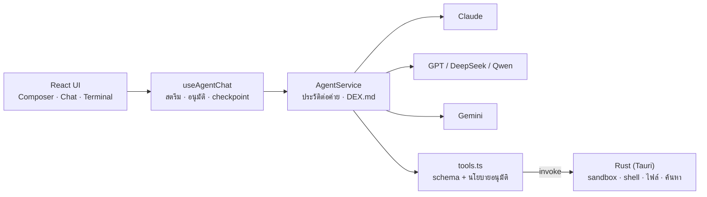

<div align="center">


# Dex — AI Coding Agent

**ผู้ช่วยเขียนโค้ดบนเดสก์ท็อป ที่อ่าน ค้นหา แก้ไฟล์ และรันคำสั่งในโปรเจกต์ของคุณได้จริง**<br/>
ใช้ได้หลายค่าย (Claude · GPT · Gemini · DeepSeek · Qwen) ขออนุญาตก่อนทำสิ่งเสี่ยงทุกครั้ง และย้อนการแก้ไฟล์ได้

[](https://tauri.app)
[](https://react.dev)
[](https://www.typescriptlang.org)
[](https://www.rust-lang.org)
[](#)

[ฟีเจอร์](#-ฟีเจอร์) · [เริ่มใช้งาน](#-เริ่มใช้งาน) · [วิธีใช้](#-วิธีใช้) · [ความปลอดภัย](#-ความปลอดภัย) · [สถาปัตยกรรม](#-สถาปัตยกรรม) · [พัฒนาต่อ](#-พัฒนาต่อ)

</div>

---

## ✨ ฟีเจอร์

| | |
|---|---|
| 🤖 **หลายค่ายในแอปเดียว** | Claude, GPT, Gemini, DeepSeek และ Qwen สลับโมเดลกลางแชทได้ ประวัติแปลงข้ามค่ายให้อัตโนมัติ |
| 🧠 **ปรับระดับการคิดได้** | ตั้งแต่ *เร็ว* ไปจนถึง *สูงสุด* แสดงเฉพาะระดับที่โมเดลนั้นรองรับ และกดดูกระบวนการคิดได้ |
| 🛠️ **ทำงานกับไฟล์จริง** | อ่าน เขียน แก้เฉพาะจุด ค้นหาทั้งโปรเจกต์ และรัน PowerShell โดยมี diff ให้ดูก่อนอนุญาต |
| ↩️ **ย้อนการแก้ไฟล์ได้** | ทุกเทิร์นที่ agent แก้ไฟล์จะมีปุ่ม **ย้อนการแก้ไฟล์** (หรือพิมพ์ `/undo`) ไฟล์ที่ agent สร้างใหม่จะถูกลบออก |
| 📋 **คำสั่งประจำโปรเจกต์** | วาง `DEX.md` หรือ `AGENTS.md` ไว้ที่รากโปรเจกต์ แล้ว agent จะทำตามทุกเทิร์น |
| 🖼️ **แนบรูปได้** | วางด้วย `Ctrl+V` ลากไฟล์มาวาง หรือกดปุ่มแนบ รูปใหญ่จะถูกย่อให้อัตโนมัติ |
| 🔐 **ขออนุญาตก่อนทำสิ่งเสี่ยง** | โหมด Auto-Pilot / Supervised, กฎ allow/deny ของคุณเอง และป้องกันไฟล์ลับอย่าง `.env` |
| 💻 **Terminal ในตัว** | ดู output ของคำสั่งแบบสด หยุดคำสั่งที่ค้างได้ |
| 🎨 **ธีมโปเกมอน** | สว่าง / มืด / ตามระบบ และ Pikachu, Poké Ball, Squirtle, Bulbasaur, Gengar |
| 🌏 **ไทย / English** | ทั้งหน้าจอและภาษาที่ agent ใช้ตอบ |

## 🚀 เริ่มใช้งาน

### สิ่งที่ต้องมี

- [Node.js](https://nodejs.org) 20 ขึ้นไป
- [Rust](https://rustup.rs) (stable)
- [ส่วนประกอบที่ Tauri ต้องใช้บน Windows](https://tauri.app/start/prerequisites/) (WebView2 และ Microsoft C++ Build Tools)

### ติดตั้งและรัน

```bash
git clone https://github.com/Thawatchai-Yodyeam/Dex-AI-coding-agent.git
cd Dex-AI-coding-agent
npm install
npm run tauri dev
```

หรือดับเบิลคลิก `run.bat`

### ใส่ API key

ใส่ได้ 2 แบบ:

1. **ในแอป:** ⚙️ ตั้งค่า → เลือกค่าย → วางคีย์
2. **ไฟล์ `.env`** ที่โฟลเดอร์ที่รันแอป แอปจะโหลดคีย์ให้แต่ไม่บันทึกลงเครื่อง (`.env` อยู่ใน `.gitignore` แล้ว)

```env
ANTHROPIC_API_KEY=...
OPENAI_API_KEY=...
GEMINI_API_KEY=...          # หรือ GOOGLE_API_KEY / GOOGLE_GENERATIVE_AI_API_KEY
DEEPSEEK_API_KEY=...
DASHSCOPE_API_KEY=...       # Qwen (หรือ QWEN_API_KEY)
```

## 📖 วิธีใช้

### คำสั่งในช่องแชท

| คำสั่ง | ทำอะไร |
|---|---|
| `/help` | ดูโมเดล ระดับการคิด workspace และไฟล์คำสั่งประจำโปรเจกต์ที่กำลังใช้ |
| `/undo` | ย้อนไฟล์ที่ agent แก้ในเทิร์นล่าสุด |
| `/clear` | ล้างการสนทนานี้ |

### คำสั่งประจำโปรเจกต์ (`DEX.md`)

สร้างไฟล์ที่รากของ workspace (แอปใช้ไฟล์แรกที่เจอตามลำดับ `DEX.md` → `AGENTS.md` → `CLAUDE.md`):

```markdown
# กติกาของโปรเจกต์นี้
- ใช้ pnpm ไม่ใช้ npm
- แก้โค้ดแล้วรัน `pnpm test` ทุกครั้ง
- คอมเมนต์เป็นภาษาไทย
```

ไฟล์นี้ถูกอ่านใหม่ทุกเทิร์น แก้แล้วมีผลทันที (เก็บได้สูงสุด 20,000 ตัวอักษร)

### ย้อนการแก้ไฟล์

- ใต้คำตอบที่มีการแก้ไฟล์จะมีป้าย **แก้ N ไฟล์** และปุ่ม **ย้อนการแก้ไฟล์** (กด 2 ครั้งเพื่อยืนยัน)
- การย้อนเทิร์นเก่าจะย้อนเทิร์นที่ตามมาทั้งหมดด้วย ไฟล์จึงกลับไปอยู่ในสภาพก่อนเทิร์นนั้นจริง ๆ
- หลังย้อน agent จะได้รับแจ้งในเทิร์นถัดไป จึงรู้ว่าต้องอ่านไฟล์ใหม่

> [!NOTE]
> Checkpoint เก็บในหน่วยความจำ ปิดแอปแล้วจะย้อนไม่ได้ และไม่รวมไฟล์ที่ถูกแก้ด้วยคำสั่ง shell ไฟล์ที่ใหญ่เกิน 5 MB หรือไม่ใช่ไฟล์ข้อความจะขึ้นป้ายเตือนว่าย้อนไม่ได้

### แนบรูป

แนบได้สูงสุด 5 รูปต่อข้อความ (PNG, JPEG, WebP, GIF) รูปที่ขอบยาวเกิน 1568px จะถูกย่อลง ส่วน DeepSeek ยังรับรูปไม่ได้ ปุ่มแนบจึงถูกปิดไว้

> [!TIP]
> รูปไม่ถูกบันทึกในประวัติแชทเพราะใหญ่เกิน localStorage พอเปิดแชทเก่าจะเห็นเป็นป้าย "รูป (ไม่ได้บันทึกไว้)"

## 🔐 ความปลอดภัย

Dex แก้ไฟล์จริงในเครื่องคุณ จึงมีการป้องกันหลายชั้น:

- **Sandbox:** tool ไฟล์ทุกตัวทำงานได้เฉพาะใน workspace ที่เลือก (เช็กเป็นราย component ของ path ไม่ใช่แค่ prefix)
- **ไฟล์ลับ:** `.env`, `*.pem`, `id_rsa`, `.npmrc` ฯลฯ ต้องขออนุญาตก่อนอ่านหรือแก้ทุกครั้ง และ `grep_search` จะข้ามไฟล์เหล่านี้
- **คำสั่ง shell:** คำสั่งที่อ่านอย่างเดียวรันได้เลยในโหมด Auto-Pilot ส่วนคำสั่งที่เขียนไฟล์ ลบไฟล์ หรือต่อกันหลายคำสั่งต้องถามก่อน และคำสั่งอันตราย (เช่น shutdown) ถูกบล็อกเสมอ
- **กฎสิทธิ์:** ตั้ง allow/deny ได้เองใน ⚙️ ตั้งค่า โดย deny ชนะเสมอ ปุ่ม *อนุญาตตลอดแชทนี้* / *อนุญาตเสมอ* จะสร้างกฎให้อัตโนมัติ
- **Supervised:** ปิด Auto-Pilot (ปุ่ม ⚡ มุมขวาบน) แล้ว agent จะถามก่อนแก้ไฟล์หรือรันคำสั่งทุกครั้ง

## 🧩 สถาปัตยกรรม



<details>
<summary><b>โครงสร้างไฟล์</b></summary>

```
src/
  App.tsx                   layout หลัก + เชื่อม hooks
  App.css                   ธีม (design tokens, light/dark + ธีมโปเกมอน)
  components/               Sidebar, TopBar, Composer, ChatMessageItem, DiffViewer, SettingsModal, ...
  hooks/
    useAppSettings.ts       settings + โหลดคีย์จาก .env (ไม่บันทึกคีย์จาก .env ลงเครื่อง)
    useChatSessions.ts      ประวัติแชท (บันทึกแบบ debounce, ไม่เก็บข้อมูลรูป)
    useAgentChat.ts         ส่งข้อความ / สตรีม / อนุมัติ tool / หยุด / checkpoint + undo
  services/
    tauriBridge.ts          เรียกคำสั่งฝั่ง Rust
    agent/
      AgentService.ts       ประวัติแบบ native ต่อค่าย, rollback เมื่อยกเลิก, โหลด DEX.md
      tools.ts              tool schema ชุดเดียว + handler + นโยบายอนุมัติ + snapshot ก่อนเขียน
      history.ts            แปลง/ตัดประวัติโดยไม่ทำให้คู่ tool call/result ขาด
      prompt.ts             system prompt + คำสั่งประจำโปรเจกต์
      providers/            anthropic.ts, openai.ts, google.ts
  utils/
    images.ts               อ่าน/ย่อรูปก่อนแนบ
    i18n.ts                 ข้อความไทย/อังกฤษ
src-tauri/src/lib.rs        คำสั่ง Rust: shell, ไฟล์ (sandbox), snapshot/restore, ค้นหา, security check (+ unit tests)
```

</details>

## 🧪 พัฒนาต่อ

```bash
npx tsc --noEmit                                     # ตรวจ type
npm test                                             # vitest
cargo test --manifest-path src-tauri/Cargo.toml --lib  # เทสต์ฝั่ง Rust
npm run build                                        # build หน้าเว็บ
npm run tauri build                                  # สร้างตัวติดตั้ง
```

### แผนต่อไป

- [ ] Context compaction (สรุปประวัติเก่าแทนการตัดทิ้ง)
- [ ] Tool `web_fetch` และ git (`status` / `diff` / `commit`)
- [ ] `@ไฟล์` mention ในช่องแชท
- [ ] รองรับ MCP servers
- [ ] ค้นหาและ export ประวัติแชท
- [ ] ประเมินค่าใช้จ่าย ($) ต่อ session

---

<div align="center">
<sub>สร้างด้วย Tauri + React · Dex ทำงานกับไฟล์จริงในเครื่อง ควรตรวจสอบก่อนอนุญาตทุกครั้ง</sub>
</div>
