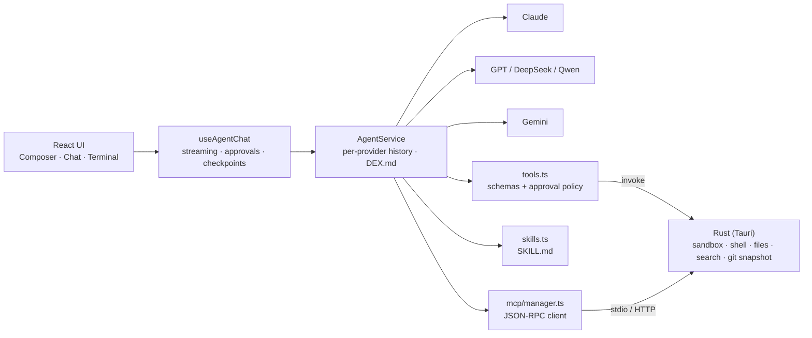

<div align="center">


# Dex — AI Coding Agent

**A desktop coding assistant that really reads, searches, edits files and runs commands in your project.**<br/>
Works with many providers (Claude · GPT · Gemini · DeepSeek · Qwen · Ollama/OpenRouter), connects to MCP servers and Skills, asks before anything risky, and can undo its file edits.

[](https://tauri.app)
[](https://react.dev)
[](https://www.typescriptlang.org)
[](https://www.rust-lang.org)
[](#)

[Features](#-features) · [Getting started](#-getting-started) · [Usage](#-usage) · [Security](#-security) · [Architecture](#-architecture) · [Development](#-development)

</div>

---

## ✨ Features

| | |
|---|---|
| 🤖 **Many providers, one app** | Claude, GPT, Gemini, DeepSeek, Qwen and OpenAI-compatible endpoints (Ollama, LM Studio, OpenRouter). Switch models in the middle of a chat. |
| 🧠 **Adjustable thinking** | From *fast* to *maximum*, showing only the levels the model supports. You can expand its thinking to read it. |
| 🛠️ **Works on real files** | Reads long files in pages with line numbers, makes several edits at once, searches with regex or glob, and runs PowerShell, with a diff to review before you approve. |
| ⏱️ **Long and background commands** | Timeouts of up to 30 minutes, and dev servers can run in the background (stop them from the Terminal). |
| 🧩 **Skills and MCP** | Loads specialised instructions from `SKILL.md` and connects to MCP servers (stdio or HTTP) using a Claude Desktop style config. |
| 🛍️ **Customizations** | A marketplace in the sidebar for installing ready-made MCP servers and skills. Hosted servers sign in with your browser, and keys and tokens stay in Credential Manager. |
| ↩️ **Undo file edits** | The **Undo file changes** button (or `/undo`) reverts files changed by tools and, if the workspace is a git repo, by shell commands too. Checkpoints are saved to disk, so undo still works after you reopen the app or it crashes. |
| 🔁 **Regenerate and edit** | Regenerate an answer, or edit an earlier message and resend from there. The agent still remembers the tools it used in earlier turns. |
| 💾 **Picks up where you left off** | Full history, including tool results, is saved per chat, so you can switch chats or reopen the app and keep working. |
| 📎 **`@file`** | Type `@` in the chat box and pick a file. Its contents are attached right away, so the agent spends no step reading it. |
| 🔎 **Web search** | The agent can search the web with a Brave or Tavily key you add, with any model. Claude can use its own built-in search instead. |
| 🌐 **Reads web pages** | The `web_fetch` tool reads docs, changelogs and issues (HTML is converted to text and split into pages). It asks before each new domain. |
| 🧭 **In-app browser** | A pane on the right (🗔 button, top right) lets the agent open your dev server and test it: read the page outline, click, type, press keys, check the console and errors, and take screenshots for models that can see images. You can use the URL bar yourself too. |
| 🎨 **Dex Design** | Ask for a website, app screen or prototype in chat and see it on a canvas beside the conversation. Switch between desktop, tablet and mobile, click part of the page to comment on it, compare options side by side, go back to old versions and export as HTML. The agent can open the page to check its own work. |
| 📄 **Word documents** | The `docx` tool reads and edits `.docx` files through the built-in G-docx editor, keeping the formatting it does not touch. |
| 📋 **Project instructions** | Put a `DEX.md` or `AGENTS.md` in the project root and the agent follows it every turn. |
| 🖼️ **Image attachments** | Paste with `Ctrl+V`, drag a file in, or use the attach button. Large images are resized automatically. |
| 🤖 **Subagents** | For broad research, the agent hands a brief to a read-only subagent that works in its own context and returns only a report, so the chat fills up more slowly. Several run in parallel. |
| 📋 **Plan mode** | Press **Plan** (top right) or type `/plan`, and the agent reads the code and proposes a plan without changing anything. Approve it with one click to start. |
| 🔐 **Asks before anything risky** | Auto-Pilot and Supervised modes, your own allow/deny rules, protection for secret files like `.env`, and API keys stored in Windows Credential Manager. |
| 💰 **Economical and resilient** | Claude prompt caching, automatic retries when an API is briefly down, summaries of old conversation when context runs low (recent turns stay whole), and a check-in every 50 steps. |
| 🔔 **Notifications** | Windows notifications when work finishes or needs approval while you are in another window. |
| 💻 **Built-in terminal** | Watch command output live and stop commands that hang. |
| 🎨 **Pokémon themes** | Light, dark or system, plus Pikachu, Poké Ball, Squirtle, Bulbasaur and Gengar. |
| 🌏 **Thai and English** | For both the interface and the language the agent replies in. |

## 🚀 Getting started

### Requirements

- [Node.js](https://nodejs.org) 20 or later
- [Rust](https://rustup.rs) (stable)
- [Tauri's Windows prerequisites](https://tauri.app/start/prerequisites/) (WebView2 and Microsoft C++ Build Tools)

### Install and run

```bash
git clone --recursive https://github.com/Thawatchai-Yodyeam/Dex-AI-coding-agent.git
cd Dex-AI-coding-agent
npm install
npm run tauri dev
```

Or double-click `run.bat`.

### Add an API key

There are two ways:

1. **In the app:** ⚙️ Settings → API Keys, then paste your key. It is stored encrypted in Windows Credential Manager, not localStorage. Keys from older versions are moved automatically.
2. **A `.env` file** in the folder you run the app from. The app loads the keys but does not save them to your machine. `.env` is already in `.gitignore`.

To use local models or OpenRouter: ⚙️ Settings → API Keys → **Custom endpoint**, then enter a Base URL (such as `http://localhost:11434/v1`) and model names separated by `,`. The model must support tool calling.

```env
ANTHROPIC_API_KEY=...
OPENAI_API_KEY=...
GEMINI_API_KEY=...          # or GOOGLE_API_KEY / GOOGLE_GENERATIVE_AI_API_KEY
DEEPSEEK_API_KEY=...
DASHSCOPE_API_KEY=...       # Qwen (or QWEN_API_KEY)
```

## 📖 Usage

### Chat commands

| Command | What it does |
|---|---|
| `/help` | Shows the model, thinking level, workspace, project instructions file and available skills |
| `/undo` | Reverts the files the agent changed in the latest turn |
| `/plan` | Turns Plan mode on or off |
| `/clear` | Clears this conversation |
| `/skill-name message` | Uses that skill for this request right away |
| `@path` | Attaches a workspace file's contents to your message (type `@` and pick from the list; secret files and files under a deny rule are not attached) |

### Skills

A skill is a folder containing a `SKILL.md`, the same format as Agent Skills:

```markdown
---
name: release
description: Publish a new release. Use when the user asks to bump the version or write a changelog
---
1. Read CHANGELOG.md ...
```

Put it in `.dex/skills/<name>/` (or `.claude/skills/`) in a project, or in `~/.dex/skills/<name>/` for every project.
The agent sees only the name and description, and loads the full instructions with `use_skill` when the task matches. Turn each one on or off in ⚙️ Settings → Skills and MCP.

### MCP servers

Go to ⚙️ Settings → Skills and MCP and paste a config in the same format as Claude Desktop or `.mcp.json`:

```json
{
  "mcpServers": {
    "filesystem": { "command": "npx", "args": ["-y", "@modelcontextprotocol/server-filesystem", "D:/projects"] },
    "remote": { "type": "http", "url": "https://example.com/mcp", "headers": { "Authorization": "Bearer ${MY_TOKEN}" } }
  }
}
```

- `${NAME}` in args, env, url and headers is replaced by a key saved in Customizations or by an environment variable, so tokens need not be kept in settings.
- Remote servers that support it can sign in with your browser instead: use `{ "type": "http", "url": "https://…", "auth": "oauth" }` and press **Sign in** next to the server. This follows the [MCP authorization spec](https://modelcontextprotocol.io/specification/2026-07-28/basic/authorization) with dynamic client registration, so a server must offer a `registration_endpoint`. For CI, keep using a token in `headers`.
- MCP tools are named `mcp__<server>__<tool>` and **always ask before running**, except those that declare `readOnlyHint` in Auto-Pilot mode or have an allow rule of type *MCP tool*.
- `"disabledTools": ["tool_name"]` on a server turns off individual tools, using the names the server declares. They are not sent to the model and cannot be called. Customizations → Installed writes this for you.
- stdio and Streamable HTTP are supported (the older SSE transport is not). Connection status and errors appear on the settings page.

### Customizations

Open **Customizations** in the sidebar to browse the **Marketplace** and manage what is **Installed**.

- **Before you install**, each plugin shows the exact command or URL it uses, who publishes it, and whether it comes from the community rather than the service's owner.
- **MCP plugins** add an entry to the same config as ⚙️ Settings → Skills and MCP, so you can still edit them there. Their tools ask before running under the usual rules.
- **Tool usage:** every tool's schema is sent with every request and billed as input. The Installed tab shows how many tools each server adds and their estimated size, warns when plugins reach about 10k tokens or the total passes 50 tools, and lets you turn off single tools without reconnecting. Turning a tool on or off in the middle of a chat restarts Claude's prompt cache and drops its earlier reasoning, because Claude's API ties both to the tool list.
- **Tool limits:** OpenAI refuses more than 128 tools in a request and the Gemini API more than 512. Other providers document no fixed limit. Dex does not block a request itself, because limits change. When a provider refuses the tool list, the chat explains how many tools to turn off instead of showing the raw API error.
- **Skill plugins** write `~/.dex/skills/<name>/SKILL.md`. They contain instructions only, and nothing runs. Dex never overwrites or deletes a skill you wrote yourself.
- **Keys** go to Windows Credential Manager as `mcp-secret-<NAME>`, and the config stores only `${NAME}`. A saved key takes priority over an environment variable of the same name. Uninstalling a plugin deletes its keys.
- **Sign-in:** plugins marked `auth: 'oauth'` open your system browser when you install them, so there is no key to create. Tokens go to Credential Manager as `mcp-oauth.<server>.<part>`, split into parts because one entry holds at most 2,560 bytes. Rust adds the `Authorization` header itself, and uninstalling or signing out deletes the tokens from this computer. To remove the access completely, do it in the settings of that service. A plugin you installed with a key before it moved to sign-in shows **Update**: it signs you in first, then deletes the old key.
- **Requirements:** `npx` plugins need [Node.js](https://nodejs.org/) and `uvx` plugins need [uv](https://docs.astral.sh/uv/getting-started/installation/). Remote plugins and skills need neither. Dex checks for the program before you install, and you need to reopen Dex after installing one so it can see the new `PATH`.
- **Versions:** `npx` and `uvx` plugins run an exact package version, because servers start on their own each time Dex opens. When a newer Dex ships a new version, the plugin shows **Update** with the old and new command. Nothing updates until you choose it, and your enabled or disabled setting stays as it was. Pinning covers the plugin's own package; `npx` and `uvx` may still resolve its dependencies to newer versions.

To add a plugin, add it to `src/services/marketplace/catalog.ts`. `marketplace.test.ts` checks that its config parses, that it declares the keys it uses and that it pins a version. Pass keys through `env` or `headers`, never `args`, because other programs on the computer can read process arguments. When you change a version, check flags and variable names in that release's package, since a repository's README can describe changes that are not released yet. Use `remoteOauth` only after checking the vendor's docs and its live metadata for `registration_endpoint` and `S256`.

### Project instructions (`DEX.md`)

Create this file in the workspace root. The app uses the first one it finds, in the order `DEX.md` → `AGENTS.md` → `CLAUDE.md`:

```markdown
# Rules for this project
- Use pnpm, not npm
- Run `pnpm test` after every code change
- Write comments in Thai
```

The file is read again every turn, so edits apply immediately (up to 20,000 characters).

### Web search

Turn it on in ⚙️ Settings → API Keys → **Web search**.

- **Search service (any model):** choose Brave Search or Tavily and paste your key. The agent gets a `web_search` tool that returns titles, links and short snippets, then reads the pages that matter with `web_fetch`. The key goes to Credential Manager as `search-brave` or `search-tavily` and never reaches the web page side of the app. You can set `BRAVE_API_KEY` or `TAVILY_API_KEY` instead. Each search is billed by that service under your plan.
- **Claude's built-in search:** tick **Claude: use Claude's built-in search instead** and Claude runs its searches on Anthropic's side, billed to your Claude account at $10 per 1,000 searches, at most 5 per request. While it is on, Dex's `web_search` is not sent to Claude, so the two never clash; other providers keep using the search service. Searches appear in the chat as **Web search** cards with the links found.
- **Gemini and OpenAI:** these use the search service above. Google's terms for Gemini's built-in search do not allow its results to be stored or reused except to show them to the user, which conflicts with how Dex saves chats, switches providers and summarizes with subagents. OpenAI offers its built-in search only through the Responses API, while Dex uses Chat Completions.
- Search queries go only to the service you chose. In Supervised mode each search asks first, and a *deny* rule of type web for `api.search.brave.com` or `api.tavily.com` blocks it. Search is read-only, so it also works in Plan mode and in subagents. Results are treated as untrusted web content.

### Subagents

When a question means reading many files, such as mapping how a feature works across the codebase, the agent can call the `subagent` tool with a written brief instead of reading everything itself.

- A subagent starts with an empty history, uses the same model, and returns one report. Only that report enters the chat's history, so the files it read do not use up the chat's context.
- It is read-only: it can read and search files, run read-only shell commands, fetch web pages, and use skills and MCP tools that declare `readOnlyHint`. It cannot edit files, start background commands, use the browser pane, Word documents or designs, or start another subagent. Shell commands that would change something are refused before you are asked.
- Its tool calls appear in the chat, indented under the **Subagent** card, and ask for approval under your usual rules. Expand the card to read the brief and the report.
- Several subagent calls in one step run in parallel. Each stops after 40 steps and reports what it found so far.
- Its tokens are counted in the turn's total. Subagents work in Plan mode too, since they change nothing.

### Plan mode

Turn it on with the **Plan** button at the top right or by typing `/plan`. The setting is remembered until you turn it off.

- The agent can read files, search, fetch web pages, look at pages in the browser pane and run read-only shell commands such as `git status`. Everything that would change something is refused before it runs and the agent is told why: writing or editing files, shell commands that are not read-only (even with an allow rule), background commands, clicking or typing in the browser, saving Word documents, writing designs, and MCP tools that do not declare `readOnlyHint`.
- Each turn reminds the agent to reply with a plan: what it will change and where, in what order, how it will check the result, and what it is unsure about.
- Under the latest plan, press **Approve plan and start**. This turns Plan mode off and tells the agent to carry out the plan. To change the plan instead, just type what you want; the agent stays in Plan mode.
- Turning Plan mode on in the middle of a turn takes effect from the next tool the agent calls. Answers written in Plan mode are marked **Plan**.
- Plan mode works together with Auto-Pilot and Supervised: tools that it lets through still follow your permission rules and approvals.

### Undoing file edits

- Answers that changed files show an **N files changed** label and an **Undo file changes** button (press twice to confirm).
- Undoing an older turn also undoes every turn after it, so files really return to their state before that turn.
- If the workspace is a git repo, Dex takes a snapshot before the first shell command that might change files (shown as **incl. shell commands**), so undo also restores files that shell commands changed, created or deleted. The snapshot uses a temporary index, does not touch your stage, stash or branch, and skips files in `.gitignore`.
- After an undo, the agent is told in the next turn, so it knows to read those files again.
- Checkpoints are written to the app data folder (`checkpoints/<chat>/<turn>.json`) as soon as a file is about to change, so undo still works after you close the app or it crashes in the middle of a turn. They are deleted when you undo the turn, regenerate from it, or clear or delete the chat.
- Saved checkpoints are kept for 7 days. Undoing an old turn overwrites what you changed in those files since then, and a turn marked **incl. shell commands** puts the whole workspace back to its snapshot, so check the date of the turn before you undo it. Git may also clean up an old snapshot, in which case only the files the agent edited with its own tools are restored.
- The earlier content of secret files such as `.env` is kept in memory only and never written to app data. After reopening the app, undo tells you that it could not restore them.

> [!NOTE]
> Files over 5 MB and non-text files show a warning that they cannot be undone.

### Dex Design

Type something like "design a landing page for a coffee shop" in chat, or press the 🎨 button at the top right to see all projects.

- Projects live in `.dex/designs/<name>/` in the workspace as plain HTML, CSS and JS, so you can open, edit and commit them like any other files.
- Each agent write becomes one version. The latest 30 are kept in `.versions/`, which stays out of git. View an old version from the toolbar and press **Use this version** to bring it back as a new version, so nothing is lost.
- The download button copies the design files to a folder you choose, without overwriting anything.
- **Comment on the page:** press the comment button on the toolbar, click part of the page, type what should change, then press **Send to Dex**. The agent knows which element you mean, and the pin disappears once it is done. Comments are kept in the project's `comments.json`.
- **Compare options:** ask for something like "give me 3 directions" and the agent creates each as its own page. Switch between them with the tabs, or press **Compare** to see them together.

### Attaching images

Attach up to 5 images per message (PNG, JPEG, WebP, GIF). Images with a long edge over 1568px are scaled down. DeepSeek cannot accept images yet, so the attach button is disabled for it.

> [!TIP]
> The chat view does not store images, because chats are saved to disk often while streaming. Reopened chats show an "Image (not saved)" label instead, but the agent still remembers the image from the history saved to file.

## 🔐 Security

Dex edits real files on your machine, so it has several layers of protection:

- **Sandbox:** all file tools work only inside the selected workspace (checked per path component, not just by prefix).
- **Secret files:** `.env`, `*.pem`, `id_rsa`, `.npmrc` and similar always need permission to read or edit, and `grep_search` skips them.
- **Shell commands:** read-only commands run straight away in Auto-Pilot. Commands that write or delete files, or chain several commands, ask first. Dangerous commands such as shutdown are always blocked.
- **Permission rules:** set your own allow and deny rules in ⚙️ Settings (shell, read file, edit file, MCP tool, web). Deny always wins. The *For this chat* and *Always allow* buttons create rules for you.
- **Supervised:** turn off Auto-Pilot (⚡ button, top right) and the agent asks before every file edit and command.
- **Plan mode:** blocks every tool that would change files or state until you approve the agent's plan, whatever your allow rules say.
- **MCP:** servers start only from the config on the settings page (a project's `.mcp.json` is not read, so an unfamiliar project cannot make the app run programs), and MCP tools ask before running.
- **Web:** `web_fetch` asks before each new domain, even in Auto-Pilot, because a URL can be used to send data out. You can set allow rules such as `docs.rs` or `*.github.com`. Redirects are followed only within the same domain, and the agent is told that web content is data and that it must not follow instructions in it.
- **In-app browser:** pages in the pane cannot call Dex's commands (Tauri blocks external origins), and the pane cannot open Dex's own pages or `file://`. localhost opens straight away in Auto-Pilot, other sites ask first under the same domain rules as `web_fetch`, and running JavaScript on pages other than localhost needs approval every time.
- **Dex Design:** AI-written design pages open from a `127.0.0.1` server as an external origin, so they cannot call Dex's commands. You type comments in the app, not in the page, so a page cannot write requests on your behalf, and text from the page reaches the model marked as data. The server serves only project files through a URL with a random token, and a CSP stops pages sending data out with `fetch` or forms (images, fonts and libraries can still load from CDNs). File writes follow the same permission rules and Supervised mode as normal edits.
- **API keys:** stored in Windows Credential Manager, not localStorage.
- **MCP sign-in:** the whole OAuth flow runs in Rust, so the webview never receives a token and cannot choose where a refresh token is sent. The browser redirect is received on `127.0.0.1` only and any request with a wrong `state` is discarded. A token is sent only to the resource it was issued for, never over plain HTTP to another computer, and never along a redirect. Addresses that a server sends for sign-in must be `https`, so a server cannot make Dex open a `file:` or similar link.

## 🧩 Architecture



<details>
<summary><b>File structure</b></summary>

```
src/
  App.tsx                   main layout + wires the hooks together
  App.css                   themes (design tokens, light/dark + Pokémon themes)
  components/               Sidebar, TopBar, Composer, ChatMessageItem, DiffViewer, SettingsModal,
                            SkillsSettings, McpSettings, ModelOptions, BrowserPane, DesignCanvas,
                            CustomizationsPage, PluginDialog, ...
  hooks/
    useAppSettings.ts       settings, keys in Credential Manager/.env, keeps MCP servers in sync with config
    useChatSessions.ts      chat history (saves only changed chats, warns when saving fails) + loads native history from file
    useFileMentions.ts      file list when typing @ in the chat box
    useAgentChat.ts         send / stream / approve / stop / checkpoint + undo / regenerate / notifications
  services/
    tauriBridge.ts          calls to Rust commands
    sessionStore.ts         one file per chat in app data (moved from localStorage automatically)
    checkpointStore.ts      one file per turn with the files' earlier content, for undo after a restart
    agent/
      AgentService.ts       native per-provider history, export/restore/rewind, step limit, merges a turn's tools
      tools.ts              tool schemas + handlers + approval policy + runs read-only tools in parallel
      history.ts            converts/trims history + clears old tool results to fit the context budget
      compaction.ts         summarises old turns with the model when history is nearly full
      planMode.ts           which tools Plan mode lets through + the notes sent to the agent
      subagent.ts           read-only subagent: its tools, system prompt and run loop
      webSearch.ts          web_search tool, which search the chat uses, Claude's built-in search tool
      mentions.ts           attaches the contents of files the user @-mentions
      retry.ts              retries on 429/5xx/529/network loss (exponential backoff + retry-after)
      skills.ts             finds/reads SKILL.md, use_skill tool, /skill-name
      prompt.ts             system prompt + project instructions + skill list
      providers/            anthropic.ts (prompt caching), openai.ts (+ custom endpoint), google.ts, toolLimits.ts (per-provider tool limits and clear errors)
    browser/
      pane.ts               browser pane state + follows the frame's position in the layout
      actions.ts            browser tool actions (navigate/snapshot/click/type/...) over the DevTools protocol
      pageScripts.ts        scripts that run in the page (outline + refs, console capture)
    docx/
      editor.ts             docx tool talks to G-docx (plugins/gdocx, a git submodule) in the browser pane
    design/
      canvas.ts             canvas state: projects, versions, comment mode and screen size emulation in the browser pane
      comments.ts           stores comments + checks data from the page + builds the message sent to chat
      commentScripts.ts     comment mode scripts that run in the design page (highlight, clicks, pins)
      guidelines.ts         design guidelines given to the model when a project is created or opened
    mcp/
      config.ts             reads Claude Desktop style config
      client.ts             JSON-RPC client + stdio / Streamable HTTP transports
      manager.ts            starts/stops servers, merges tools as mcp__server__tool, leaves out disabled tools
      oauth.ts              sign-in helpers for the UI (the tokens themselves stay in Rust)
      toolUsage.ts          estimated size of the tools sent to the model
    marketplace/
      catalog.ts            the plugins in the Marketplace (data only)
      skillPacks.ts         instructions of the skills that ship with the Marketplace
      plugins.ts            install state read from the real config/folders, install/uninstall/enable
  utils/
    images.ts               reads/resizes images before attaching
    notify.ts               Windows notifications
    i18n.ts                 Thai and English strings
src-tauri/src/lib.rs        Rust commands: shell (timeout/background), files (sandbox, paging, multi-edit),
                            search (regex/glob), git snapshot, checkpoint files, web search (Brave/Tavily), keyring, skills, MCP transport, web_fetch,
                            browser pane (child webview + WebView2 DevTools protocol), design server (+ unit tests)
```

</details>

## 🧪 Development

```bash
npm run typecheck                                    # type check
npm run lint                                         # ESLint
npm test                                             # vitest
npm run build                                        # build the web app (needed before cargo test)
cargo test --manifest-path src-tauri/Cargo.toml --lib  # Rust tests
npm run tauri build                                  # create the installer
```

---

<div align="center">
<sub>Built with Tauri + React · Dex works on real files on your machine, so review before you approve.</sub>
</div>
